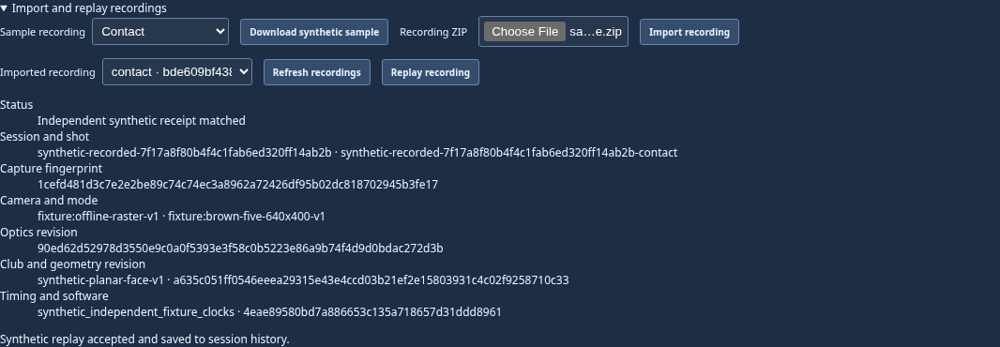

# Gates 20–28 — independent recording register

Approved baseline is PR #48 at `4eae89580bd7a886653c135a718657d31ddd8961`.
This increment keeps the existing acquisition, preflight, marker, geometry,
Electron and archive boundaries. It is software-only.

In the existing offline synthetic review, open **Import and replay
recordings**. Download a controlled sample, choose its ZIP, import it and
replay. The server issues the independent receipt when it generates the
fixture, before the import. Only an exact ZIP with a pre-existing receipt
from this local database is admitted. The ZIP cannot issue or replace that
receipt. Earlier ZIPs and ZIPs from another installation require separately
admitted receipts, a workflow outside this increment.

The existing SQLite session database keeps versioned receipts and imports in
separate tables. A receipt includes ZIP SHA, capture fingerprint, shot and
session IDs, synthetic camera mode/revision, profile and geometry revisions,
software SHA, independent fixture-clock provenance, marker rasters and their
digests, and labelled landmark coordinates. The register detects changed
receipt bytes and validates independent timing and all revisions before
the existing marker runner. Successful replay uses the existing history,
statistics and JSON export. Rejected data stays out of accepted shot history.
The local controlled register caps imports at 2 MiB each and issues up to 32
receipts. A restart preserves imported selections in the register and saved
results in history.

## Gate evidence and open work

- Gates 20–24 exercise multiple controlled scenes, missing and ambiguous
  landmarks, altered recordings and deterministic replay. Existing tests
  cover stale profile, changed geometry, host-clock alias and trigger
  bracketing. Acceptance is synthetic.
- Gates 25–28 exercise real React import and archive/export and the frozen
  Windows backend and renderer. The native file picker has browser fixture
  coverage through a file input. Windows smoke supplies the file through
  the same input and exercises the real packaged UI and Python service.
- Software gaps include an independently authorized portable receipt
  provisioning workflow, physical-device identity integration and
  long-running retention management for the current bounded register.
- DirectShow `VideoCapture(index)` cannot verify continuity of device
  identity after USB re-enumeration. Windows device-interface/serial evidence
  would need to be tied to the opened handle and tested across reconnect.
  The current adapter uses host arrivals only. Sensor-clock provenance must
  be demonstrated by the selected device and driver before physical analysis.
- Physical acceptance needs documented attach/detach/reconnect and identity
  swap trials, actual delivered mode/FPS and exposure/gain checks, independent
  exposure-clock and trigger verification, calibrated optics and club geometry,
  labelled landmark/pose trials, and impact error/uncertainty and rejection
  measurements against an independent ground truth. No physical tests ran.

