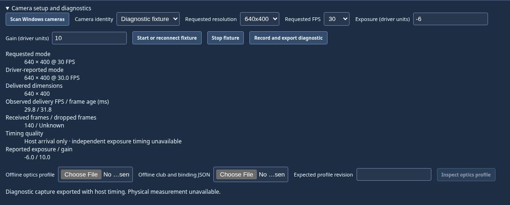

# Gates 25–28 — camera setup and diagnostic capture

Starting point: draft PR #49 at `421023aeee543e1f43901380da45d0f9a16dde35`.
Project Law V1 and MDP V1.2 limit this iteration to software preparation.

## Terminal-free preparation on Windows

1. Unzip the portable package, keep its directory together and double-click
   **OpenFlight Face Impact.exe**.
2. Open the Face Impact dashboard and expand **Camera setup and diagnostics**
   below the dashboard grid. Connect the ELP OV9281 and click **Scan Windows cameras**.
   This inventory scan does not open a camera. Record which identity appears and
   disappears on unplug and replug. Reopen the app and scan again. If experimenting
   with a different USB port, record the returned identity again.
3. Select the displayed Windows device to inspect its PnP instance identity.
   Start is disabled for that selection pending verification of the capture
   association. Use **Diagnostic fixture** to try the remainder of the workflow.
4. Choose a fixture resolution and FPS, optionally enter driver exposure/gain,
   and choose **Start or reconnect fixture**. Compare requested and reported
   settings, delivered image dimensions, observed arrival FPS and frame age.
5. Choose **Record and export diagnostic**. The diagnostic ZIP contains the
   existing lossless capture ZIP and a manifest with settings, identity, software
   and shot/session provenance. The buffered export has three frames before and
   three after the host trigger. Keep the diagnostic separate from impact results.
6. Inspect an existing offline optics profile by choosing its JSON and entering
   its independently recorded expected SHA-256 revision. Optionally choose JSON
   with `club` (the existing ClubFaceModel fields) and `binding` (the existing
   CalibrationClubBinding fields). A matching revision does not verify physical
   optics, club pose or camera mode. This workflow does not activate profiles.
7. Choose **Stop fixture** and close through the app or Windows window controls.

## Windows identity and timing

The inventory uses Windows Plug and Play instance IDs for present Camera/Image
devices. The dashboard remembers the selected device identity, including when
it is absent on a later scan. No OpenCV index is inferred from enumeration
order. Stable serial-backed IDs may survive reconnect; identical units without
serial numbers can have port/topology-dependent identifiers. Device-interface
identity must be bound to the actual opened handle before activating physical
capture. A future native DirectShow moniker or Media Foundation symbolic-link
adapter can expose this binding behind the existing single camera owner.

- **Host arrival** is recorded after OpenCV read, on a monotonic clock.
- **Driver or sample timestamps** are separate evidence. DirectShow
  `IMediaSample::GetTime` uses stream time; Media Foundation sample timestamps
  likewise have source-specific semantics. Neither establishes exposure time
  without verification. The current OpenCV DirectShow reader exposes neither
  through its frame pipeline.
- **Sensor/ exposure timing** requires verified per-frame metadata or an
  independent synchronized acquisition reference. Exposure control readback
  is a driver setting, not an exposure timestamp. The software trigger uses
  host monotonic time and does not identify a physical strike.
- A nominal 120 FPS gives 8.33 ms between arrivals, without a guarantee of
  delivery or of observing contact. The current estimator needs a defensible
  trigger bracket, independently timed samples, visible ball and face landmarks
  and a constrained pose. Present host-only data fails independent timing.
  A native sample timestamp API, validated UVC metadata, or externally
  synchronized camera/trigger are candidates. A spatial-only or extrapolated
  impact method would change the measurement contract and requires approval.

References: [Windows device instance IDs](https://learn.microsoft.com/windows-hardware/drivers/install/device-instance-ids),
[DirectShow sample timing](https://learn.microsoft.com/windows/win32/api/strmif/nf-strmif-imediasample-gettime),
[Media Foundation device symbolic links](https://learn.microsoft.com/windows/win32/medfound/mf-devsource-attribute-source-type-vidcap-symbolic-link).

## Acceptance boundaries

The packaged camera workflow is fixture-only for capture. Observed camera
delivery counters are shown; dropped frames are unknown without an independent
sequence counter. Physical open, verified identity continuity, actual frame
timing, calibration acquisition, natural landmarks and impact precision are
pending separately approved hardware work. Terminal-free physical capture
cannot be demonstrated by this package.

The recording register can remove the imported ZIP copy while retaining its
independent receipt and saved session. SQLite can reuse those pages. The
receipt limit is unchanged. A cross-installation receipt needs an independently
approved trust and provisioning mechanism. Import cannot grant that trust.

