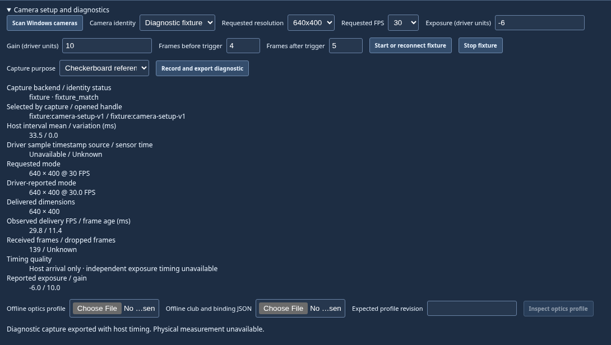

# Gates 25–28 — identity-bound camera preparation

Starting baseline is draft PR #50, `6b4c720d401ffb7715cc7d6175c3014dab241ba3`.
Project Law V1, MDP V1.2 and the active software-only gate apply.
Physical acquisition and formal gate closure remain pending.

## Adapter and fixture evidence

The existing Windows camera owner and trigger ring accept an optional
identity-capable opener. It takes the selected identity and returns a handle
that reports its actual identity. The owner validates the match before
setting controls or reading frames. A mismatched handle is released. A read
failure invalidates continuity and reopening performs the same identity
check again. Index-based DirectShow paths remain explicitly unverified.
Only the diagnostic fixture supplies a bound handle in this package.

The dashboard reports backend, selected and opened identity, continuity,
and a rolling mean and standard deviation of host frame delivery intervals.
Existing delivered dimensions, FPS, frame age, driver controls and error
status remain available. Driver sample timestamps and sensor time are
reported as unavailable. Fixture identity does not attest physical identity.

Diagnostic export supports 1–16 frames on each side of a manual host trigger.
At the maximum supported mode the raw window is bounded to about 8.2 MB.
The ZIP carries the existing lossless capture, its SHA-256 digest, requested
and driver-reported mode and controls, independently reported fixture handle,
delivered dimensions, per-window host intervals, software SHA and session
and shot identity. The operator can label a window diagnostic, checkerboard,
club landmarks or setup reference. Labels describe intent and do not create a
calibration, admit a recording to impact replay, or authorize physical claims.

## Native provider decision

The current OpenCV DirectShow code opens through an integer index. The public
capture handle does not expose the DirectShow device instance or device
interface path. The underlying OpenCV DirectShow sample callback receives a
sample but discards its timing argument and forwards pixels. A separately
enumerated PnP list cannot prove which handle that index opened, particularly
after re-enumeration or with multiple same-model devices.

The proposed forward path is a **native Media Foundation source reader**
behind the identity-capable opener, retaining one camera owner and the
same ring, timing validation, UI and ZIP writer. Enumerate video sources and
bind the exact video-device symbolic link, reconcile it with the PnP identity,
reject a missing or ambiguous match, and configure only modes/control ranges
actually negotiated by the handle. On disconnect, invalidate continuity and
require a new exact match. DirectShow moniker binding is an alternative, with
the same requirement to prove identity and timing semantics. No automatic
fallback to another device or an index. Serial-less identical units may
remain distinguishable only by USB topology, and port changes can invalidate
the binding.

Approval needed: authorize one native Media Foundation capture provider
behind the existing owner, plus opt-in **diagnostic-only** activation on a
verified selected ELP OV9281, including preview, mode/exposure/gain and
manual ZIP export on the user's Windows computer. Device and resource
failure must fail closed. This does not approve physical impact publication,
a new timing model, gate closeout or release.

## Timing and contact feasibility

- Host arrival is monotonic time after OpenCV read. It includes buffering
  and scheduling variability. Measured interval variation describes delivery.
- DirectShow sample timing and Media Foundation timestamps are stream sample
  times with backend-specific provenance. They must be measured against an
  independent reference before being treated as exposure times. Neither is
  available through the current adapter.
- UVC PTS/SCR or vendor metadata are candidates, not confirmed ELP capabilities.
  Showing exposure/gain control values does not identify exposure start.
  Software trigger time is in the host clock and does not mark physical
  contact. Independently synchronized illumination, a verified device
  clock or an external trigger are possible evidence sources.
- At 120 FPS the nominal frame interval is 8.33 ms. Subframe contact can
  occur between exposures. A motion fit to multiple ball and club observations
  might bound an interval, but cannot recover an unobserved contact by itself:
  dropouts, blur, pose ambiguity, unknown exposure and clock offset must enter
  the uncertainty model. The current independent timing policy stays in
  force. A revised estimator needs separate approval and ground truth.

References: [OpenCV DirectShow source](https://github.com/opencv/opencv/blob/4.x/modules/videoio/src/cap_dshow.cpp),
[Media Foundation capture-device symbolic links](https://learn.microsoft.com/windows/win32/medfound/mf-devsource-attribute-source-type-vidcap-symbolic-link),
[DirectShow sample time](https://learn.microsoft.com/windows/win32/api/strmif/nf-strmif-imediasample-gettime),
[Media Foundation Source Reader](https://learn.microsoft.com/windows/win32/medfound/source-reader).

## Terminal-free procedure with this package

1. Extract the complete portable directory and double-click the EXE.
2. Open the Face Impact dashboard and expand **Camera setup and diagnostics**.
3. Attach ELP, select **Scan Windows cameras**, inspect the device identity,
   and repeat after unplug/replug. Selecting a Windows entry leaves physical
   capture disabled. The package cannot export physical ELP images.
4. Choose **Diagnostic fixture**, choose mode, set before/after frame counts
   and start. Verify **fixture_match** and host interval statistics.
5. Pick a capture purpose and select **Record and export diagnostic**.
   Retain the downloaded outer ZIP with diagnostic manifest and inner
   capture ZIP. These are fixture pixels.
6. Stop the fixture and use either normal close path.

Pending physical acceptance includes exact device identity across reconnect
and replacement, negotiated modes, exposure/gain readback, dropped or invalid
frames, timing against exposure and trigger reference, and collection of
real checkerboard, setup, club and landmark materials. Gates 20–28 stay open.

